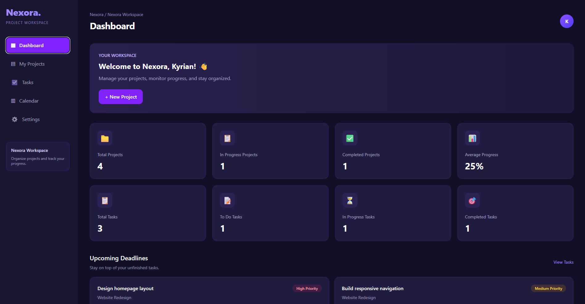
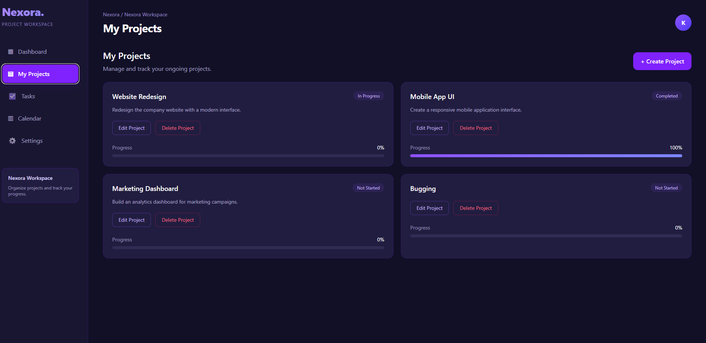
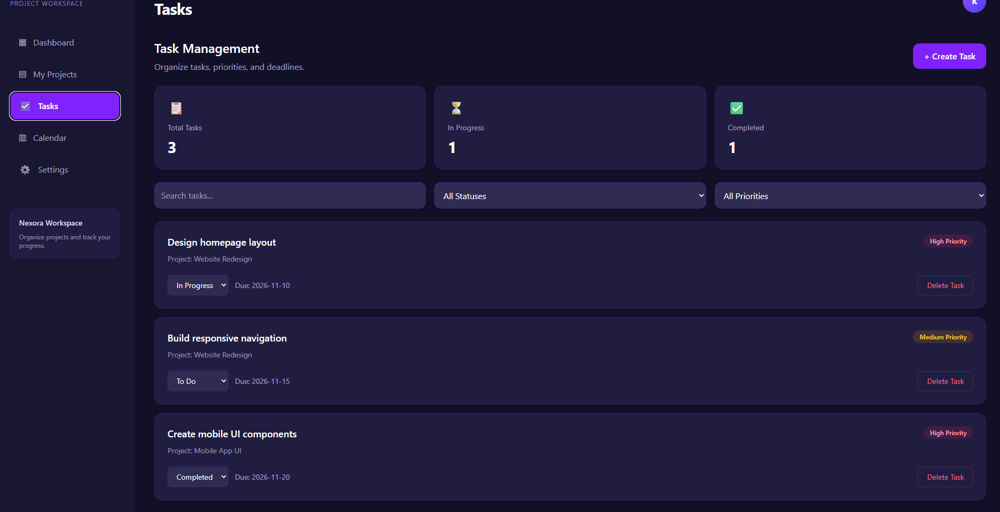
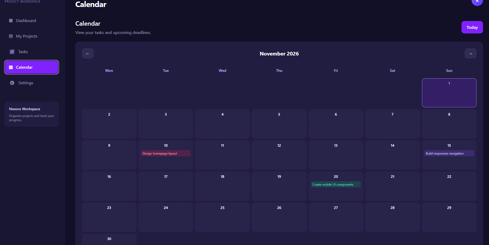

# Nexora — Project Management Dashboard

A modern, responsive project management dashboard built with **React, TypeScript, Tailwind CSS, and Vite**.

Nexora helps users organize projects, manage tasks, monitor progress, and stay on top of deadlines through a clean, intuitive interface.

This project was developed to demonstrate practical frontend development skills, including component-based UI development, state management, TypeScript, data persistence, and responsive design.

## Features

### Dashboard
- Overview of project and task statistics
- Eight dynamically updated statistics
- Automatic project progress calculations
- Upcoming deadlines with overdue and due-today indicators
- Recent projects overview

### Project Management
- Create new projects
- Edit existing projects
- Delete projects and their associated tasks
- Automatically calculate project progress
- Automatically update project status based on task completion

### Task Management
- Create tasks and assign them to projects
- Set task priorities: Low, Medium, or High
- Assign task deadlines
- Update task status: To Do, In Progress, or Completed
- Delete tasks
- Search tasks by name
- Filter tasks by status and priority

### Calendar
- Monthly calendar navigation
- Display tasks on their scheduled dates
- Highlight the current day
- Color-coded task indicators

### Workspace Settings
- Customize workspace name
- Update display name and email address
- Save preferences locally

### Data Persistence
Projects, tasks, and workspace preferences are saved using browser **localStorage**, allowing data to remain available after refreshing the page.

## Tech Stack

| Technology | Purpose |
|---|---|
| React | Building interactive user interfaces |
| TypeScript | Type-safe JavaScript development |
| Tailwind CSS | Styling and responsive layouts |
| Vite | Development server and build tooling |
| React Hooks | Component state and lifecycle management |
| localStorage | Client-side data persistence |

## Getting Started

### Prerequisites

Make sure you have installed:

- Node.js 20.19+ within the 20.x release line, or 22.12+ (required by the locked Vite and Oxlint versions)
- npm
- Git

No environment variables, API keys, or backend services are required. Nexora runs in the browser and stores data in localStorage.

### Installation

**1. Clone the repository**

```bash
git clone https://github.com/kyrian-dev/nexora.git
```

**2. Navigate into the project**

```bash
cd nexora
```

**3. Install dependencies**

```bash
npm ci
```

**4. Start the development server**

```bash
npm run dev
```

Open the local URL displayed in your terminal, typically:

`http://localhost:5173/`

### Production Build

```bash
npm run build
```

This runs TypeScript checks and creates the production build in `dist/`.

To preview that build locally:

```bash
npm run preview
```

Open the URL printed in the terminal. The preview server is for checking the build locally.

### Linting

```bash
npm run lint
```

This runs Oxlint.

## Project Structure

```text
nexora/
├── public/
├── screenshots/
├── src/
│   ├── App.tsx
│   ├── main.tsx
│   └── index.css
├── index.html
├── package.json
├── package-lock.json
├── tsconfig.json
├── vite.config.ts
└── README.md
```

## How It Works

Nexora uses React state to manage projects, tasks, and workspace preferences.

When a user creates or updates a task, the application recalculates the associated project's progress and status.

**Project progress formula:**

```text
Progress = round((Completed Tasks / Total Project Tasks) × 100)
```

Projects with no tasks show 0% progress and a Not Started status.

Task deadlines are displayed on the dashboard and calendar. The dashboard shows up to five incomplete tasks with deadlines, sorted by date, including overdue tasks.

React's `useEffect` hook synchronizes project and task data with localStorage.

## Screenshots

The following screenshots are included in the repository's `screenshots/` folder. To refresh them after UI changes, replace the corresponding PNG files and keep the filenames below, or update these image links if the filenames change.

### Dashboard



### Projects



### Task Management



### Calendar



## Future Improvements

- User authentication
- Cloud database integration
- Multi-user collaboration
- Drag-and-drop task management
- Notifications and reminders
- Activity history
- Task editing

## Current Limitations

Nexora is currently a frontend-focused application. Data is stored locally in the user's browser rather than in a cloud database.

User authentication and synchronization between devices are not yet supported.

## Author

**Obiekee Ikechukwu Kyrian**

Frontend Web Developer

GitHub: [kyrian-dev](https://github.com/kyrian-dev)

## License

This project is intended for learning and portfolio demonstration. No open-source license has been assigned yet.
